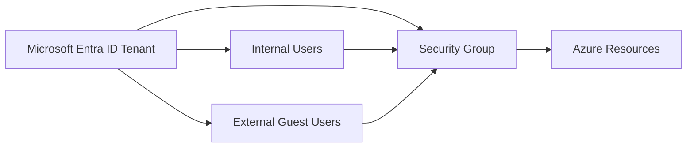
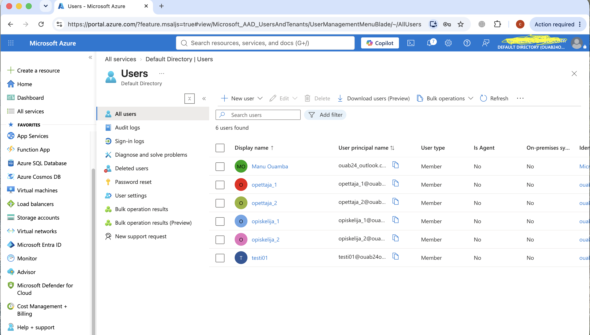
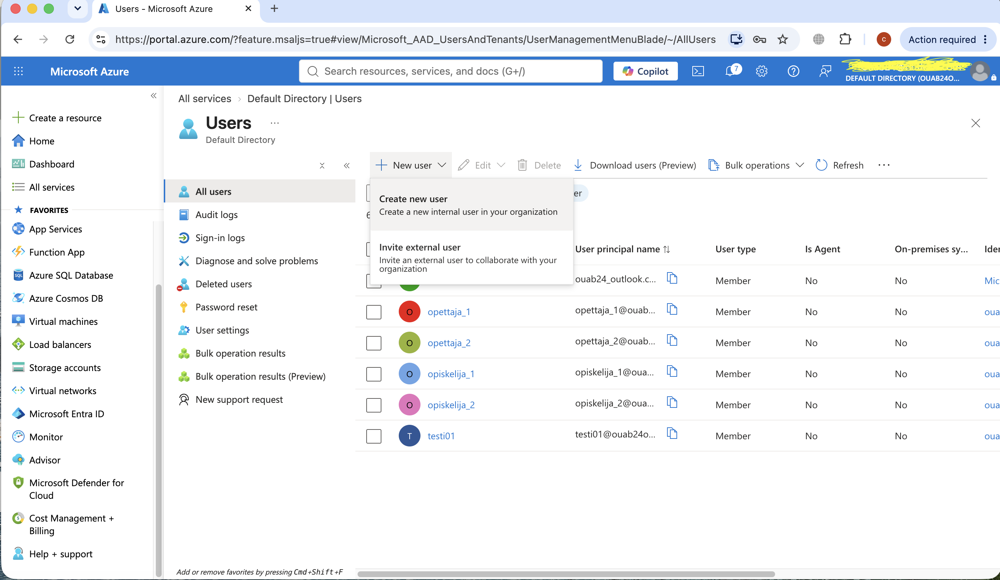
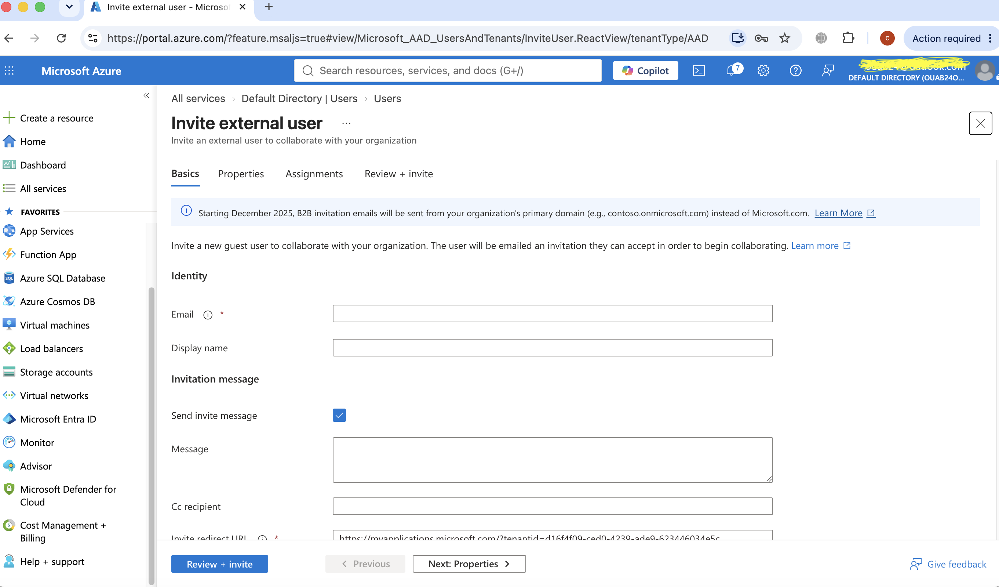
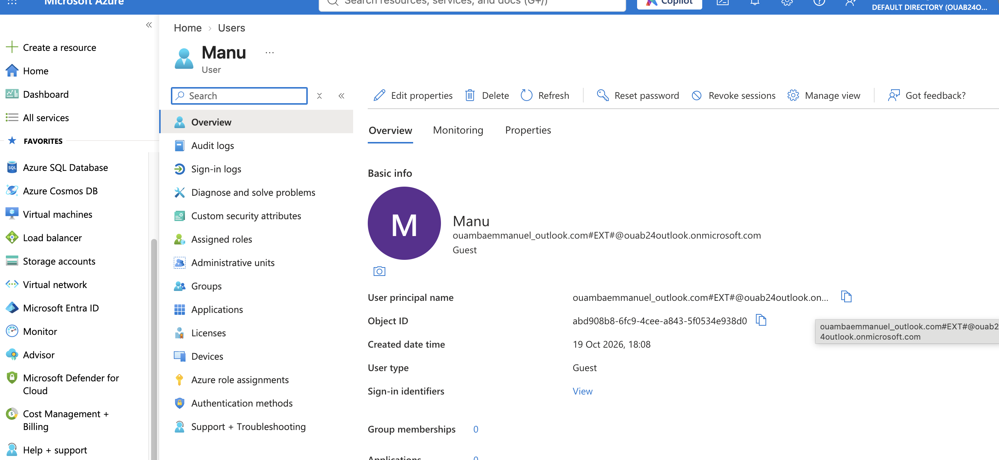
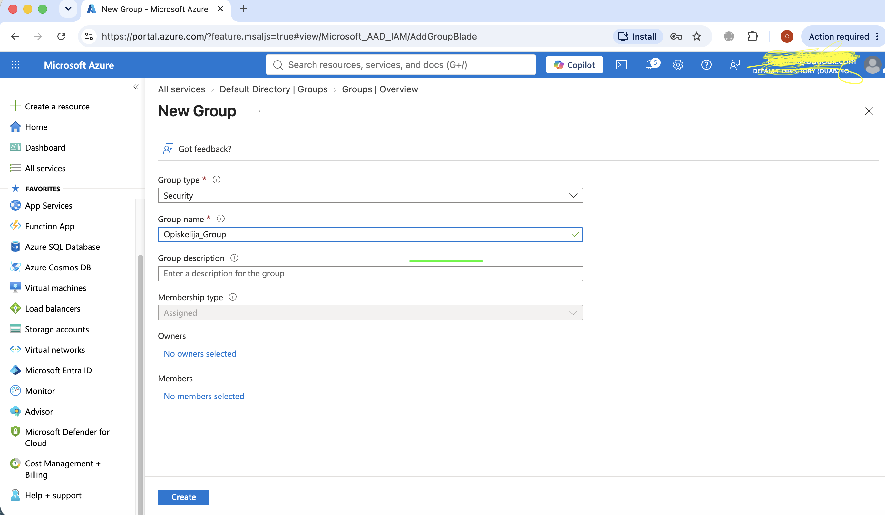
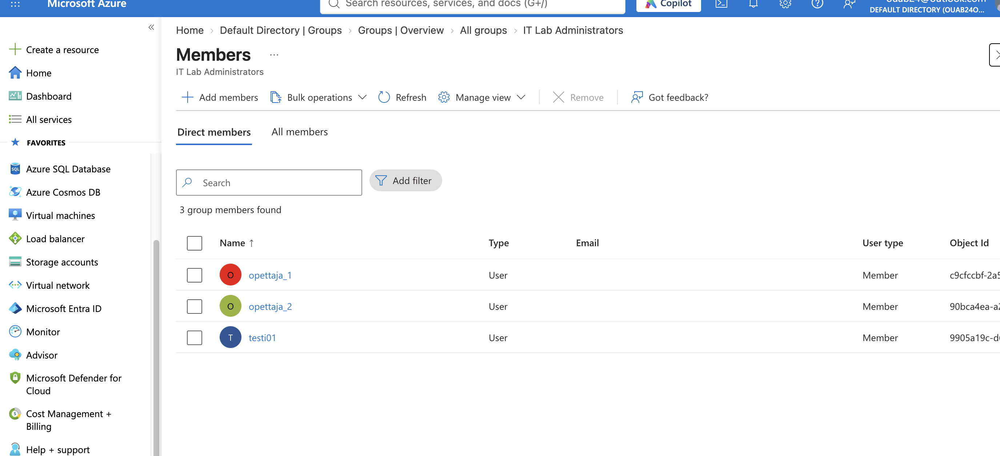

# Lab 01 - Manage Microsoft Entra ID Identities

## Overview

This lab demonstrates how to create and manage identities in **Microsoft Entra ID**, Azure's cloud-based Identity and Access Management (IAM) service.

The objective is to provision internal users, invite external guest users, and organize identities using security groups for a pre-production Azure environment.

This lab reinforces the core identity management skills required for the **Microsoft Certified: Azure Administrator Associate (AZ-104)** certification.

---

## Lab Scenario

An organization is preparing a **pre-production Azure environment** for testing applications and services.

Several engineers have been hired to manage the environment and require secure authentication through **Microsoft Entra ID**. To simplify administration, users will be organized into security groups, with the long-term goal of automatically managing group membership based on user attributes such as job title.

---

## Objectives

By completing this lab, I learned how to:

- Navigate Microsoft Entra ID
- Create internal cloud users
- Invite external guest users
- Configure user properties
- Create Microsoft Entra security groups
- Understand assigned and dynamic membership
- Verify identity configurations
- Apply identity management best practices

---

# Azure Services Used

- Microsoft Entra ID
- Azure Portal

---

## Estimated Time

**30 minutes**

---

# Architecture



### Architecture Overview

Microsoft Entra ID acts as the central identity provider for the Azure environment.

It stores:

- Internal users
- External guest users
- Security groups

Security groups can later be assigned permissions to Azure resources using **Azure Role-Based Access Control (RBAC)**.

---

# Task 1 - Review Microsoft Entra ID Users

I opened **Microsoft Entra ID** from the Azure Portal and navigated to the **Users** section.

From this page I reviewed:

- Display Name
- User Principal Name (UPN)
- User Type
- Assigned Licenses
- Account Status

This page provides a centralized view of all identities in the tenant.

## Screenshot



---

# Task 2 - Review User Creation Options

From the **New User** menu I reviewed the available options for creating identities.

Microsoft Entra ID provides two common methods:

- Create a new internal user
- Invite an external guest user

This flexibility enables organizations to manage both employees and external collaborators securely.

## Screenshot



---

# Task 3 - Create an Internal User

I created a new cloud-only user with the following configuration.

| Setting | Value |
|----------|-------|
| User Principal Name | opettaja_1 |
| Display Name | opettaja_1 |
| Password | Auto-generated |
| Account Enabled | Yes |
| Job Title | IT Lab Administrator |
| Department | IT |


After the user was created, I refreshed the Users page and verified that the account appeared successfully.

---
# Task 4 - Invite an External Guest User

I configured and sent a Microsoft Entra B2B invitation to an external collaborator.

| Setting | Verified result |
|---|---|
| Display name | `Manu` |
| User type | Guest |
| Invitation email | Enabled |
| Group assignments | None |
| Directory role assignments | None |
| Guest account created | Yes |
| Invitation acceptance | Not verified |

## Verification

I navigated to **Microsoft Entra ID > Users > All users** and verified that `Manu` appeared with **User type: Guest**.

The account's presence confirms that the guest identity was created. It does not confirm that the invitation has been accepted.

## Screenshots





## Security Considerations

Inviting a guest does not automatically grant access to Azure resources. Azure RBAC permissions must be assigned separately at an appropriate scope.

---

# Task 5 - Create a Security Group

I created a Microsoft Entra Security Group.

| Setting | Value |
|----------|-------|
| Group Type | Security |
| Group Name | Opiskelija_Group |
| Membership Type | Assigned |

Security Groups simplify permission management by allowing administrators to assign permissions to a group instead of individual users.

## Screenshot



---

## Task 6 - Configure IT Lab Administrators Security Group

I created and verified an additional Microsoft Entra ID security group for an IT administration training environment.

| Setting | Configuration |
|---|---|
| Group name | `IT Lab Administrators` |
| Group type | Security |
| Membership type | Assigned |
| Direct members | `opettaja_1`, `opettaja_2`, `testi01` |
| Total members | 3 |

### Verification

I navigated to **Microsoft Entra ID > Groups > IT Lab Administrators > Members** and confirmed that all three users appeared as direct members.

### Screenshot



### Security Consideration

Adding users to a security group does not automatically grant permissions to Azure resources. Azure RBAC role assignments must be configured separately at an appropriate scope.

No Azure RBAC role assignment was verified during this exercise.

---

# Assigned vs Dynamic Membership

## Assigned Membership

Assigned membership requires administrators to manually add or remove users from a group.

### Advantages

- Simple to manage
- Full administrative control
- Suitable for small teams

### Disadvantages

- Requires manual maintenance
- Time consuming
- Greater chance of human error

---

## Dynamic Membership

Dynamic groups automatically update membership using user or device attributes.

Example rule:

```text
user.jobTitle -eq "IT Lab Administrator"
```

Whenever a user's Job Title matches the rule, Microsoft Entra automatically adds that user to the group.

> **Note:** Dynamic Membership requires a Microsoft Entra ID Premium P1 or P2 license.

---

# Key Concepts

## Microsoft Entra ID

Microsoft Entra ID is Microsoft's cloud-based Identity and Access Management (IAM) service.

It provides:

- Authentication
- Authorization
- Single Sign-On (SSO)
- Identity Governance
- Multi-Factor Authentication (MFA)

---

## Tenant

A Tenant is a dedicated instance of Microsoft Entra ID that stores:

- Users
- Groups
- Applications
- Devices
- Policies

---

## User Principal Name (UPN)

The User Principal Name (UPN) is the username used to sign in.

Example:

```text
az104-user1@contoso.onmicrosoft.com
```

---

## Member User

A Member User belongs directly to the organization.

---

## Guest User

A Guest User is an external identity invited into the tenant for collaboration.

---

## Security Group

Security Groups are used to manage permissions collectively instead of assigning permissions individually.

---

# Verification

I successfully verified that:

- Microsoft Entra ID tenant was accessible.
- Users page displayed existing identities.
- New User options were available.
- Guest invitation page opened successfully.
- Security Group was created.
- Assigned Membership was selected.

---

# What I Learned

Through this lab I learned:

- Microsoft Entra ID is Azure's Identity and Access Management platform.
- Internal users and Guest users have different purposes.
- Security Groups simplify permission management.
- User properties such as Department and Job Title can automate administration.
- Dynamic Membership reduces administrative overhead.
- Some Microsoft Entra features require Premium licensing.

---

# Security Best Practices

- Follow the Principle of Least Privilege.
- Assign permissions to groups rather than individual users.
- Regularly review Guest accounts.
- Remove unused identities.
- Never expose passwords, tenant IDs, or access tokens in screenshots.
- Blur personal information before publishing screenshots.

---

# AZ-104 Exam Tips

Remember these key concepts for the exam:

- Difference between **Member** and **Guest** users.
- Difference between **Authentication** and **Authorization**.
- Difference between **Microsoft Entra Roles** and **Azure RBAC Roles**.
- Difference between **Assigned** and **Dynamic Membership**.
- Dynamic Groups require **Microsoft Entra ID Premium P1/P2** licensing.

---

# Cleanup

After completing the lab, delete any temporary resources created during testing:

- Test Users
- Guest Users
- Practice Security Groups

Always verify that users or groups are not assigned to production resources before deleting them.

---

# References

- Microsoft Learn – Microsoft Entra ID
- Microsoft Learn – Manage Users and Groups
- Microsoft Learn – Azure Administrator (AZ-104)

---

# Status

- [x] Reviewed Microsoft Entra ID
- [x] Reviewed Users
- [x] Created Internal User
- [x] Reviewed Guest Invitation
- [x] Created Security Group
- [x] Verified Configuration
- [x] Added Screenshots
- [ ] Cleanup Completed
