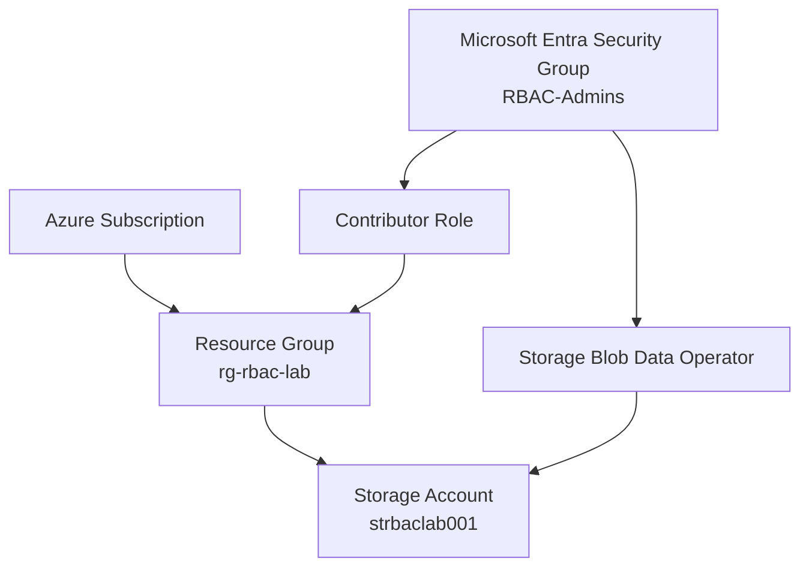
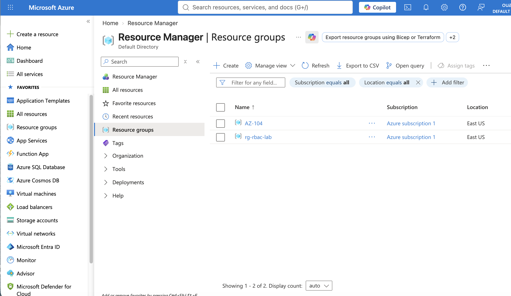
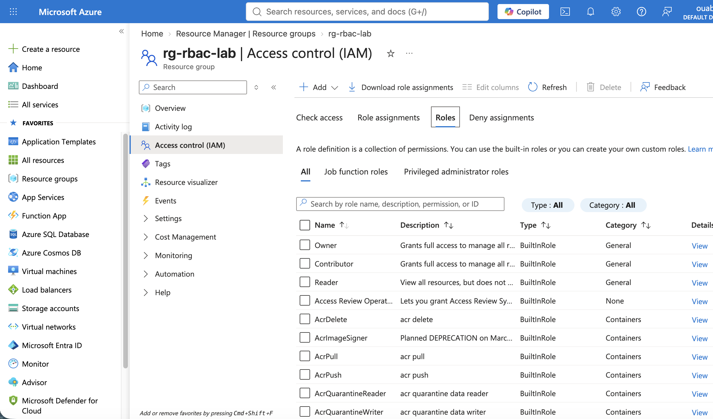
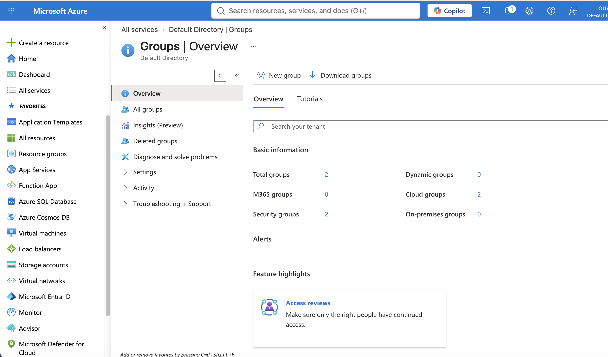
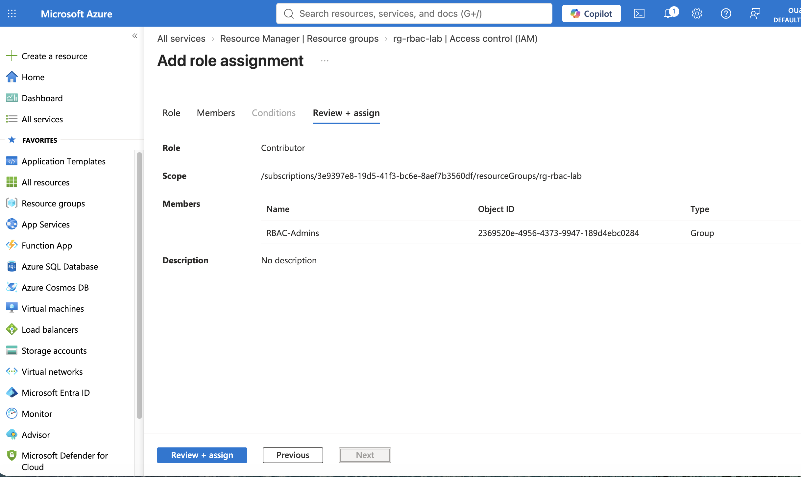
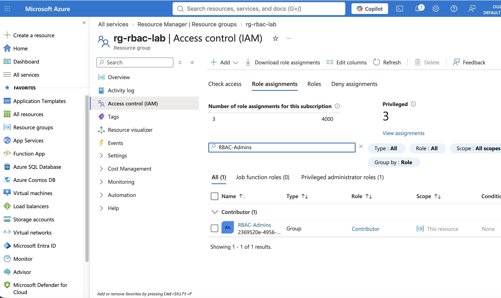
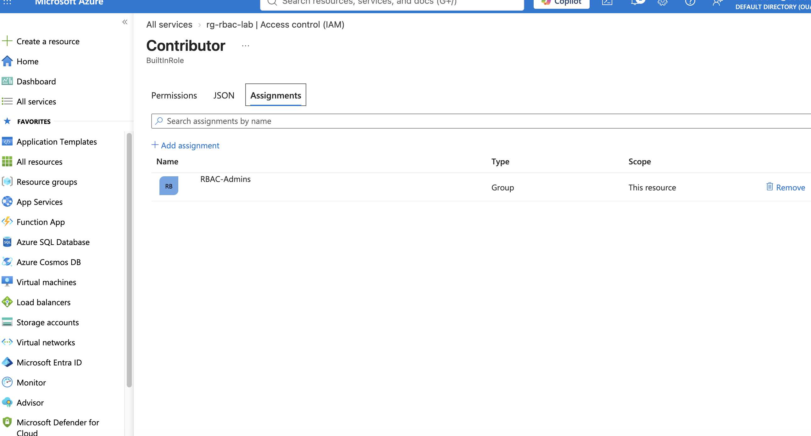
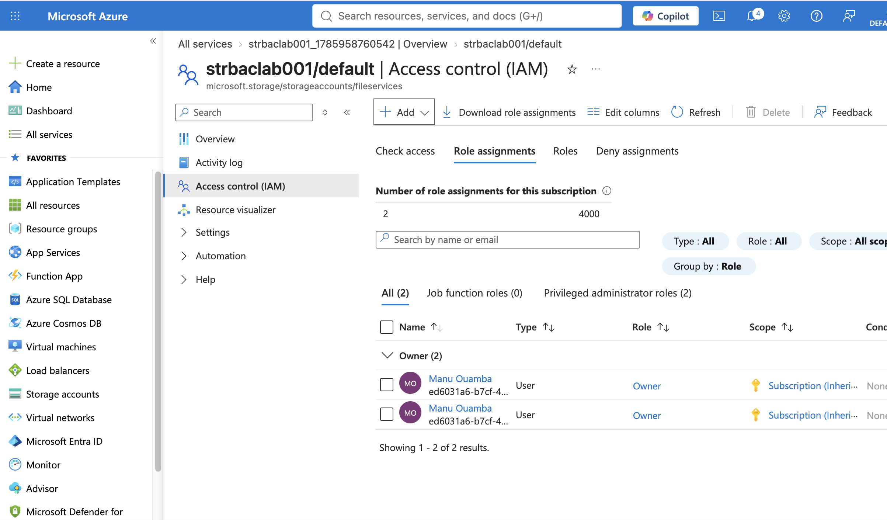
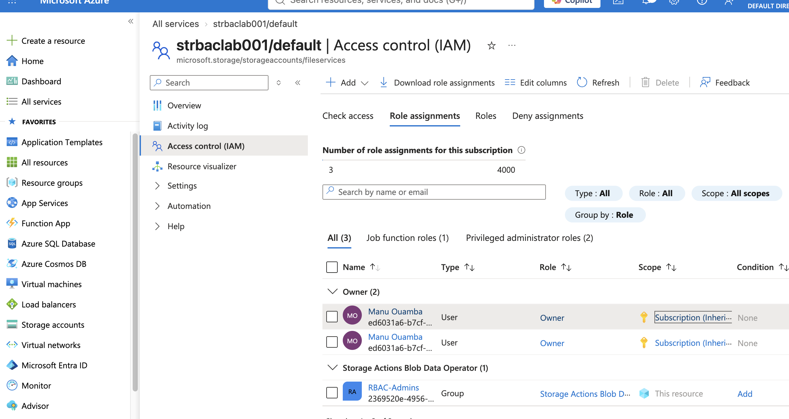

# Lab 02 - Manage Role-Based Access Control (RBAC)


## Overview

This lab demonstrates how to implement **Azure Role-Based Access Control (RBAC)** to securely manage access to Azure resources.

Azure RBAC is Azure's authorization system that enables administrators to grant users, groups, service principals, and managed identities only the permissions they require, following the **Principle of Least Privilege**.

In this lab, I created a Resource Group and a Storage Account, assigned Azure built-in roles to a Microsoft Entra Security Group, verified permissions, and removed the assignments after testing.

---

## Table of Contents

- [Overview](#overview)
- [Lab Scenario](#lab-scenario)
- [Objectives](#objectives)
- [Azure Services Used](#azure-services-used)
- [Skills Practiced](#skills-practiced)
- [Estimated Time](#estimated-time)
- [Architecture](#architecture)
- [Task 1 - Create a Resource Group](#task-1---create-a-resource-group)
- [Task 2 - Review Access Control (IAM)](#task-2---review-access-control-iam)
- [Task 3 - Create a Microsoft Entra Security Group](#task-3---create-a-microsoft-entra-security-group)
- [Task 4 - Assign Contributor Role](#task-4---assign-contributor-role)
- [Task 5 - Verify Role Assignment](#task-5---verify-role-assignment)
- [Task 6 - Review RBAC Scope](#task-6---review-rbac-scope)
- [Task 7 - Create a Storage Account](#task-7---create-a-storage-account)
- [Task 8 - Assign Storage Blob Data Operator Role](#task-8---assign-storage-blob-data-operator-role)
- [Contributor vs Storage Blob Data Operator](#contributor-vs-storage-blob-data-operator)
- [Azure RBAC Concepts](#azure-rbac-concepts)
- [Verification Checklist](#verification-checklist)
- [What I Learned](#what-i-learned)
- [Security Best Practices](#security-best-practices)
- [AZ-104 Exam Tips](#az-104-exam-tips)
- [Cleanup](#cleanup)
- [References](#references)

---

# Lab Scenario

Contoso Ltd. needs to delegate Azure resource management to the Infrastructure Team without granting full administrative permissions.

To accomplish this, Azure Role-Based Access Control (RBAC) is used to assign built-in roles to a Microsoft Entra Security Group at different Azure scopes.

---

# Objectives

By completing this lab, I learned how to:

- Understand Azure RBAC
- Create Azure Resource Groups
- Create Microsoft Entra Security Groups
- Assign built-in Azure roles
- Verify role assignments
- Understand RBAC scopes
- Apply the Principle of Least Privilege
- Remove role assignments after testing

---

# Azure Services Used

- Azure Portal
- Azure Resource Groups
- Azure Storage Account
- Microsoft Entra ID
- Azure Role-Based Access Control (RBAC)

---

# Skills Practiced

- Azure Identity Management
- Authorization
- Azure RBAC
- Access Control (IAM)
- Security Groups
- Resource Management
- Azure Storage
- Least Privilege

---

# Estimated Time

**45 Minutes**

---

# Architecture



---

# Task 1 - Create a Resource Group

I created a Resource Group named **rg-rbac-lab** to host Azure resources used throughout this lab.

| Setting | Value |
|----------|-------|
| Resource Group | rg-rbac-lab |
| Region | East US (or preferred region) |

## Screenshot



---

# Task 2 - Review Access Control (IAM)

I reviewed the **Access Control (IAM)** page of the Resource Group to understand how Azure manages authorization.

The IAM blade provides:

- Role Assignments
- Role Definitions
- Check Access
- Deny Assignments

## Screenshot



---

# Task 3 - Create a Microsoft Entra Security Group

I created a Microsoft Entra Security Group named **RBAC-Admins**.

Using Security Groups instead of assigning permissions directly to users simplifies administration.

## Screenshot



---

# Task 4 - Assign Contributor Role

I assigned the **Contributor** built-in role to the **RBAC-Admins** group at the **Resource Group** scope.

| Setting | Value |
|----------|-------|
| Role | Contributor |
| Principal | RBAC-Admins |
| Scope | Resource Group |

The Contributor role allows members to manage Azure resources but **cannot assign Azure roles**.

## Screenshot



---

# Task 5 - Verify Role Assignment

After assigning the Contributor role, I confirmed that the **RBAC-Admins** group appeared in the Resource Group's Role Assignments.

## Screenshot



---

# Task 6 - Review RBAC Scope

Azure RBAC supports multiple assignment scopes.

Permissions can be assigned at:

- Management Group
- Subscription
- Resource Group
- Individual Resource

In this lab, the Contributor role was assigned at the **Resource Group** level.

This means the RBAC-Admins group can manage only resources inside **rg-rbac-lab**.

## Screenshot



---

# Task 7 - Create a Storage Account

To demonstrate RBAC on an individual Azure resource, I created a Storage Account.

| Setting | Value |
|----------|-------|
| Name | strbaclab001 |
| Resource Group | rg-rbac-lab |

## Screenshot



---

# Task 8 - Assign Storage Blob Data Operator Role

I assigned the **Storage Blob Data Operator** role to the **RBAC-Admins** group.

Unlike Contributor, this role grants permissions specifically for Azure Blob Storage operations.

| Setting | Value |
|----------|-------|
| Role | Storage Blob Data Operator |
| Principal | RBAC-Admins |
| Scope | Azure Files service (fileServices/default) |

**Scope verification:** Azure Activity Log confirmed that the role assignment was successfully created on August 5, 2026 (HTTP 201). However, the assignment was scoped to the Azure Files service (`fileServices/default`), rather than the storage account itself. This distinction was discovered during a subsequent audit of the lab documentation. The assignment's current state has not been verified.

## Screenshot



---

# Contributor vs Storage Blob Data Operator

| Contributor | Storage Blob Data Operator |
|--------------|----------------------------|
| General Azure management role | Storage-specific role |
| Can manage Azure resources | Can manage Blob Storage operations |
| Cannot assign roles | Cannot assign roles |
| Commonly assigned at Resource Group scope | Commonly assigned at Storage Account scope |

This demonstrates Azure's **Principle of Least Privilege** by granting only the permissions required for a specific service.

---

# Azure RBAC Concepts

## Authentication vs Authorization

Authentication verifies **who** the user is.

Authorization determines **what** the authenticated user is allowed to do.

Microsoft Entra ID performs **authentication**.

Azure RBAC performs **authorization**.

---

## RBAC Components

Azure RBAC is based on three elements:

- Security Principal
- Role Definition
- Scope

Together, these form a **Role Assignment**.

---

## Built-in Roles

| Role | Description |
|------|-------------|
| Owner | Full access including assigning roles |
| Contributor | Manage resources but cannot assign roles |
| Reader | Read-only access |
| User Access Administrator | Can assign Azure roles |

---

## Azure Scope Hierarchy

```text
Management Group
        ↓
Subscription
        ↓
Resource Group
        ↓
Resource
```

Permissions assigned at higher scopes are inherited by lower scopes.

---

# Verification Checklist

- [x] Resource Group created
- [x] Microsoft Entra Security Group created
- [x] Contributor role assigned
- [x] Contributor role verified
- [x] RBAC scope reviewed
- [x] Storage Account created
- [x] Storage Blob Data Operator assigned
- [x] Role assignments verified
- [x] Role assignments removed during cleanup

---

# What I Learned

After completing this lab, I can confidently:

- Configure Azure RBAC
- Assign built-in Azure roles
- Explain RBAC scope inheritance
- Apply the Principle of Least Privilege
- Differentiate Azure RBAC from Microsoft Entra authentication
- Secure Azure resources using Security Groups

---

# Security Best Practices

- Follow the Principle of Least Privilege.
- Assign permissions to Security Groups instead of individual users.
- Prefer built-in roles over custom roles when appropriate.
- Regularly review role assignments.
- Remove temporary permissions after completing administrative tasks.

---

# AZ-104 Exam Tips

Remember these key concepts:

- Microsoft Entra ID performs Authentication.
- Azure RBAC performs Authorization.
- Owner can assign roles.
- Contributor cannot assign roles.
- Reader has read-only access.
- Azure RBAC permissions inherit through Azure scopes.
- Resource-level assignments provide more granular access than Resource Group-level assignments.

---

# Cleanup

After completing this lab, remove temporary resources:

- Delete role assignments created for testing.
- Delete the Storage Account (optional).
- Delete the Resource Group.
- Delete the RBAC-Admins Security Group if no longer required.

---

# References

- Microsoft Learn – Azure Role-Based Access Control (RBAC)
- Microsoft Learn – Azure Storage
- Microsoft Learn – Microsoft Entra ID
- Microsoft Learn – AZ-104 Azure Administrator Associate

---

# Status

- [x] Resource Group Created
- [x] Security Group Created
- [x] Contributor Role Assigned
- [x] RBAC Scope Reviewed
- [x] Storage Account Created
- [x] Storage Blob Data Operator Assigned
- [x] Verification Completed
- [x] Cleanup Completed
