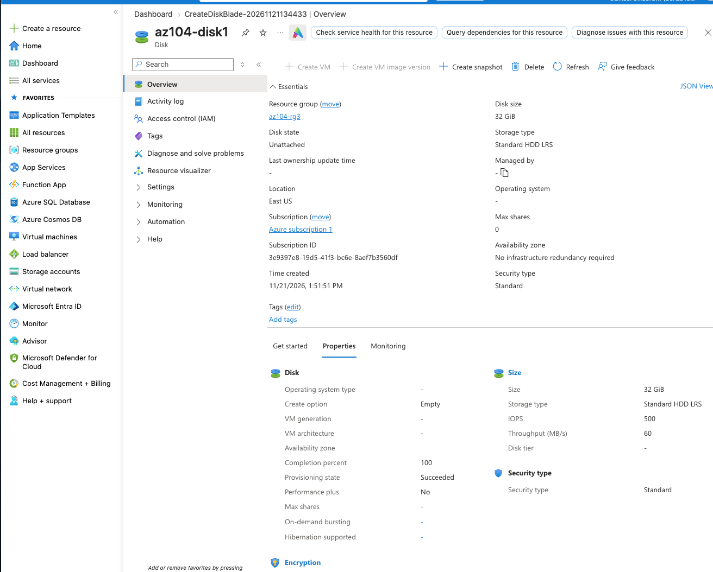
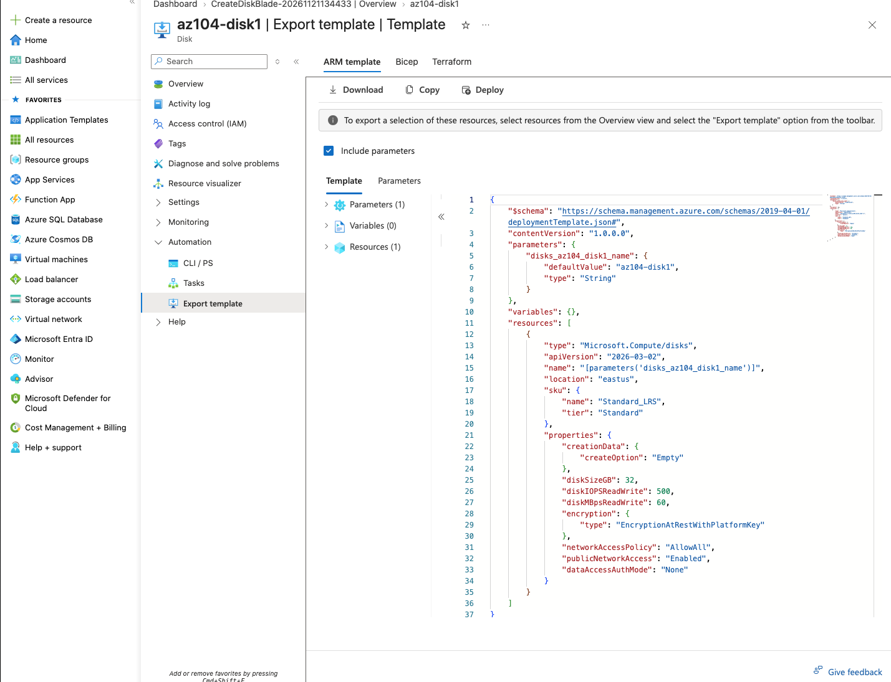
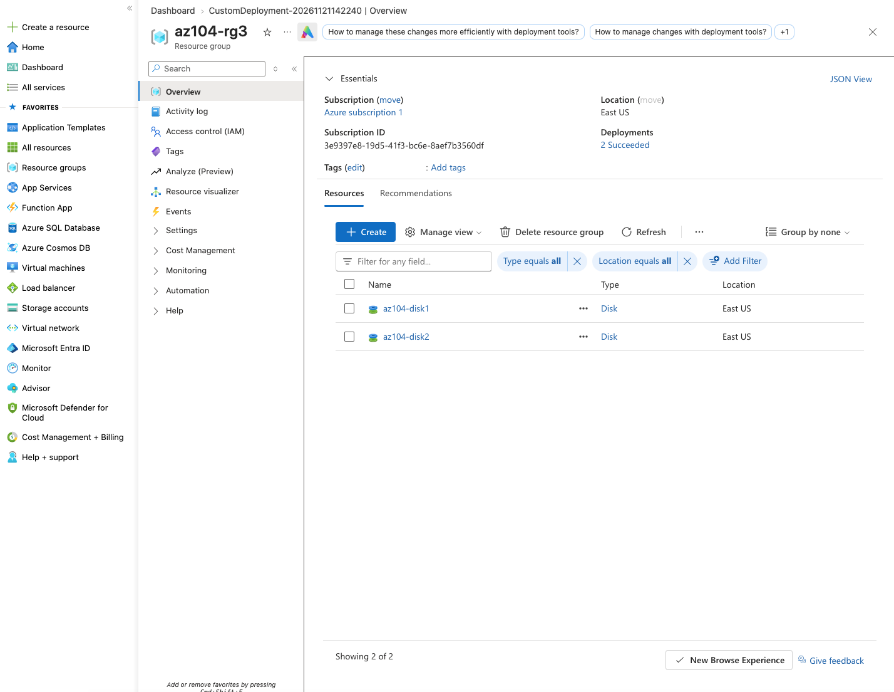
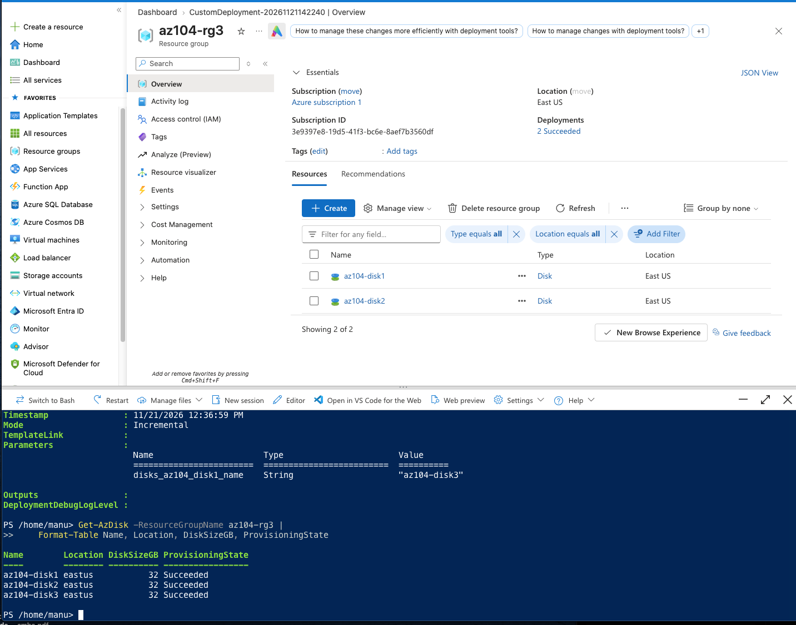
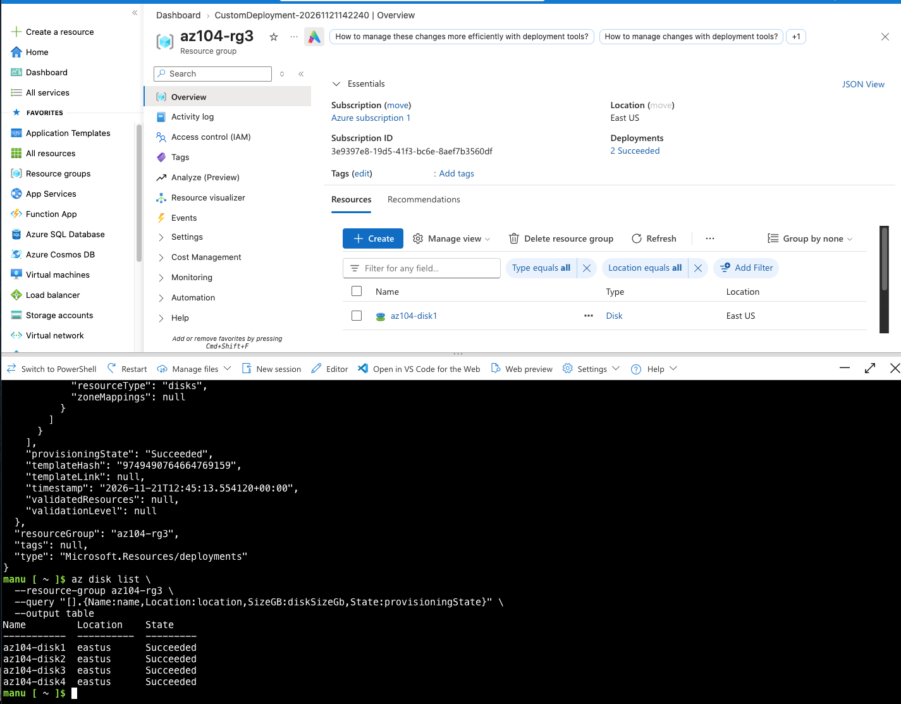
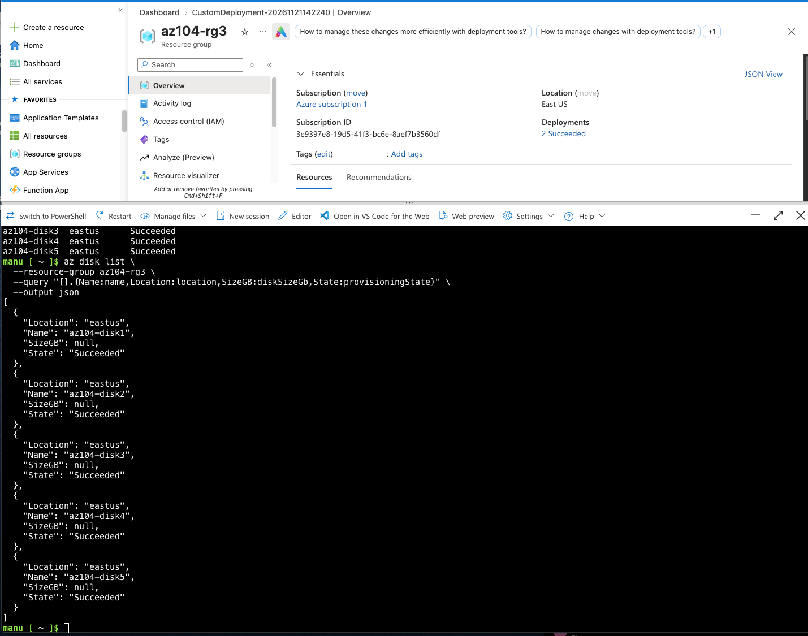

# Lab 03b — Manage Azure Resources Using ARM Templates

**Status:** Completed  
**Certification:** Microsoft Certified: Azure Administrator Associate (AZ-104)

## Overview

This lab demonstrates Infrastructure as Code (IaC) in Microsoft Azure using ARM templates, Azure PowerShell, Azure CLI, and Bicep.

The objective was to deploy five Azure managed disks using different deployment methods, validate infrastructure configurations, troubleshoot deployment errors, and safely remove resources.

## Technologies Used

- Microsoft Azure
- Azure Resource Manager (ARM)
- ARM JSON Templates
- Azure PowerShell
- Azure CLI
- Azure Bicep
- Azure Cloud Shell
- Git and GitHub

## Infrastructure Configuration

| Property | Configuration |
|---|---|
| Resource Group | az104-rg3 |
| Region | East US |
| Resource Type | Azure Managed Disk |
| Storage SKU | Standard_LRS |
| Disk Size | 32 GiB per disk |
| Number of Disks | 5 |
| Total Provisioned Storage | 160 GiB |
| Encryption | Platform-managed key |

## Task 1 — Create and Export an ARM Template

Created an Azure managed disk using the Azure Portal and exported its ARM template for reuse.

**Resource:** az104-disk1





## Task 2 — Modify and Redeploy an ARM Template

Modified the exported ARM template to deploy a second managed disk using a custom template deployment in the Azure Portal.

**Resource:** az104-disk2



## Task 3 — Deploy Using Azure PowerShell

Validated and deployed the ARM template using Azure PowerShell.

**Resource:** az104-disk3

### Validation

```powershell
Test-AzResourceGroupDeployment `
  -ResourceGroupName az104-rg3 `
  -TemplateFile template.json `
  -TemplateParameterFile parameters.json
```

### Deployment

```powershell
New-AzResourceGroupDeployment `
  -Name az104-disk3-deployment `
  -ResourceGroupName az104-rg3 `
  -TemplateFile template.json `
  -TemplateParameterFile parameters.json
```

The parameter value was set to az104-disk3 during this deployment.



## Task 4 — Deploy Using Azure CLI

Validated and deployed the same ARM template using Azure CLI.

**Resource:** az104-disk4

```bash
az deployment group validate \
  --resource-group az104-rg3 \
  --template-file template.json \
  --parameters @parameters.json
```

```bash
az deployment group create \
  --name az104-disk4-deployment \
  --resource-group az104-rg3 \
  --template-file template.json \
  --parameters @parameters.json
```



## Task 5 — Deploy Using Bicep

Converted the ARM JSON template into Bicep, resolved a read-only property warning, compiled the template, and deployed the fifth managed disk.

**Resource:** az104-disk5

### Install Bicep

```bash
az bicep install
az bicep version
```

### Decompile ARM Template

```bash
az bicep decompile --file template.json
```

### Compile Bicep

```bash
az bicep build \
  --file template.bicep \
  --outfile compiled-template.json
```

### Validate and Deploy

```bash
az deployment group validate \
  --resource-group az104-rg3 \
  --template-file template.bicep \
  --parameters diskName=az104-disk5
```

```bash
az deployment group create \
  --name az104-disk5-bicep-deployment \
  --resource-group az104-rg3 \
  --template-file template.bicep \
  --parameters diskName=az104-disk5
```



## Deployment Results

| Managed Disk | Deployment Method | Status |
|---|---|---|
| az104-disk1 | Azure Portal | Succeeded |
| az104-disk2 | Custom ARM Template | Succeeded |
| az104-disk3 | Azure PowerShell | Succeeded |
| az104-disk4 | Azure CLI | Succeeded |
| az104-disk5 | Azure Bicep | Succeeded |

## Infrastructure Files

| File | Description |
|---|---|
| [template.json](templates/template.json) | ARM infrastructure definition |
| [parameters.json](templates/parameters.json) | Deployment input parameters |
| [template.bicep](templates/template.bicep) | Bicep infrastructure definition |
| [compiled-template.json](templates/compiled-template.json) | Compiled Bicep template |

## Troubleshooting

### Invalid JSON Syntax

Encountered a JSON parsing error during PowerShell deployment validation.

Resolved the issue by correcting the parameters file and validating the deployment again.

### Bicep Warning BCP073

The decompiled Bicep template contained a read-only SKU tier property.

Resolved the warning by removing the tier property while retaining the Standard_LRS SKU.

### Bicep CLI Not Found

Installed Bicep in the Azure Cloud Shell environment and verified its availability before continuing.

## Skills Demonstrated

- Infrastructure as Code
- ARM template authoring and parameterization
- Azure resource provisioning
- PowerShell automation
- Azure CLI automation
- Bicep decompilation and compilation
- Infrastructure validation
- Deployment troubleshooting
- Cloud cost management
- Azure resource lifecycle management

## Resource Cleanup

Removed the lab resource group and all five managed disks to prevent unnecessary charges.

```bash
az group delete --name az104-rg3 --yes
```

Verified deletion:

```bash
az group exists --name az104-rg3
```

Result: `false`

## Security Considerations

The disk networking configuration was retained for educational purposes. Production deployments should enforce appropriate network access restrictions and organizational security policies.

Review template parameters and create the target resource group before redeploying. The included parameters file targets az104-disk4.

## Reference

[Microsoft Official AZ-104 Lab 03b](https://github.com/MicrosoftLearning/AZ-104-MicrosoftAzureAdministrator/blob/master/Instructions/Labs/LAB_03b-Manage_Azure_Resources_by_Using_ARM_Templates.md)

