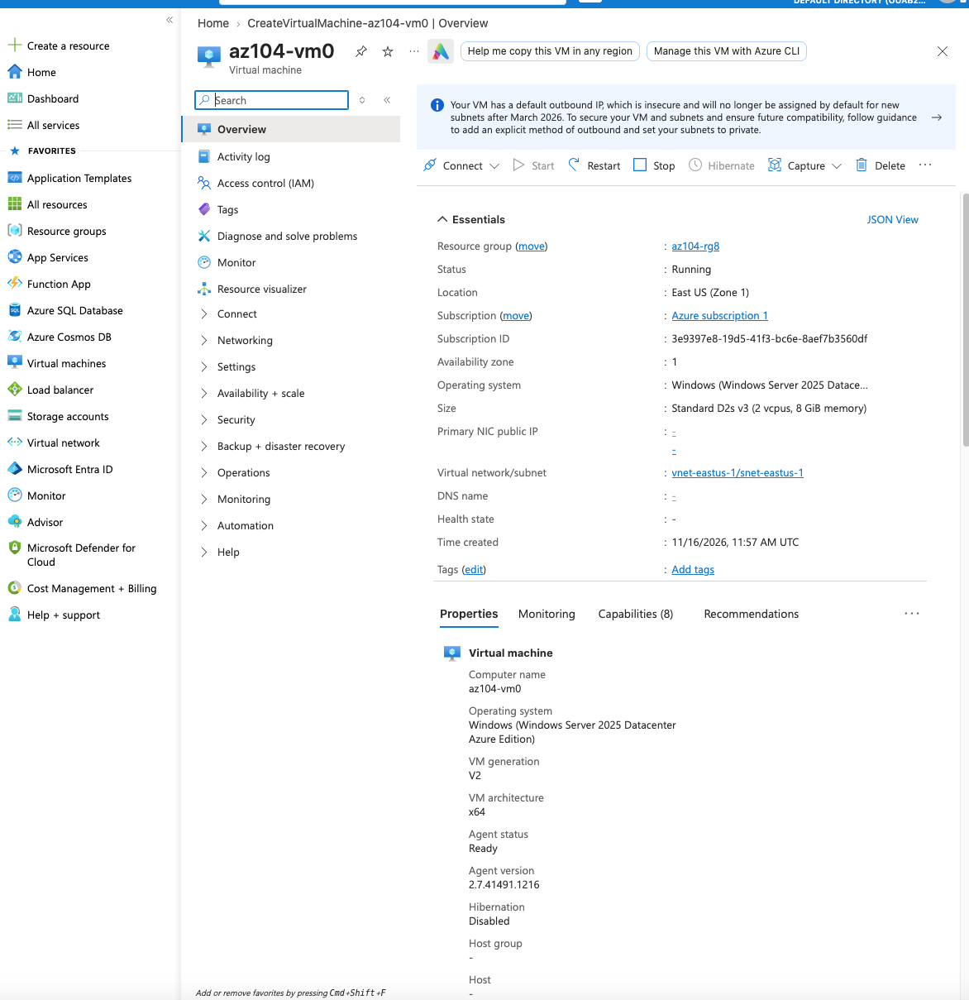
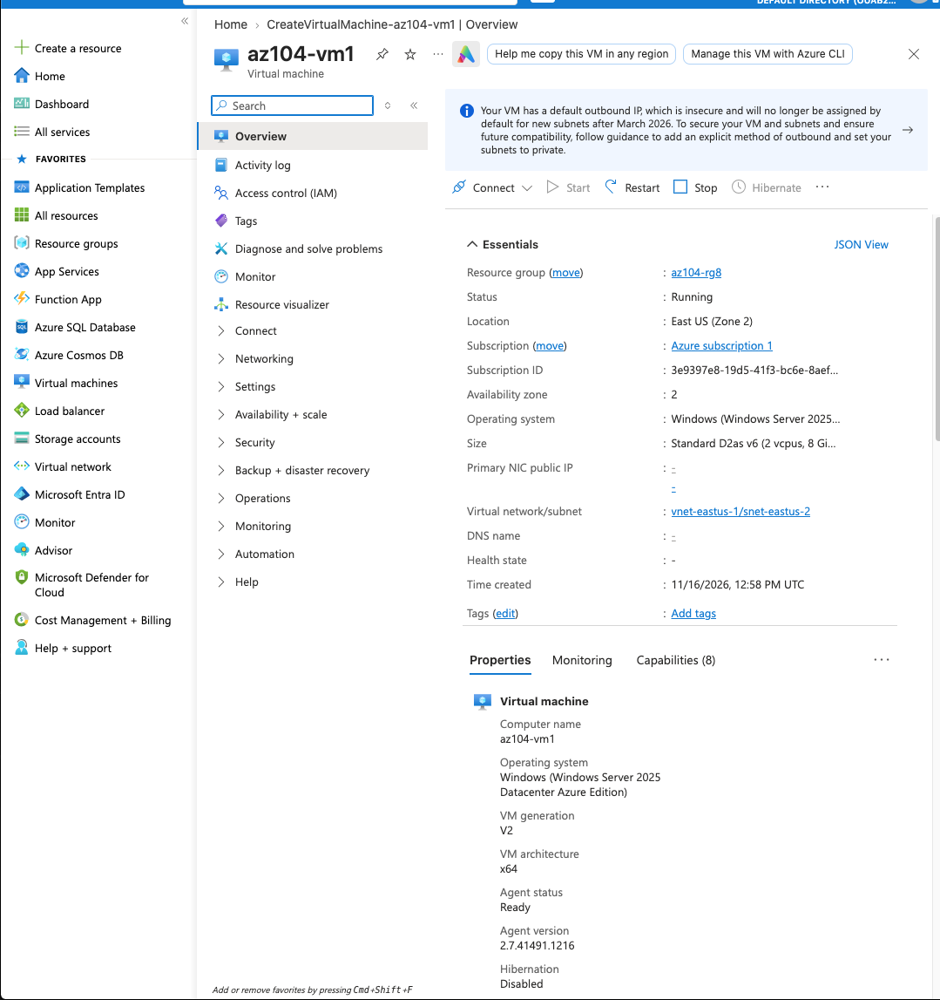
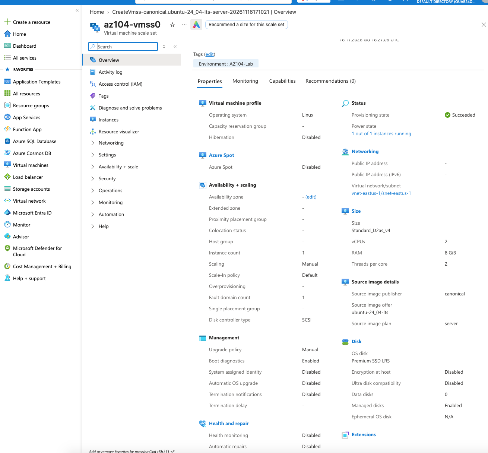
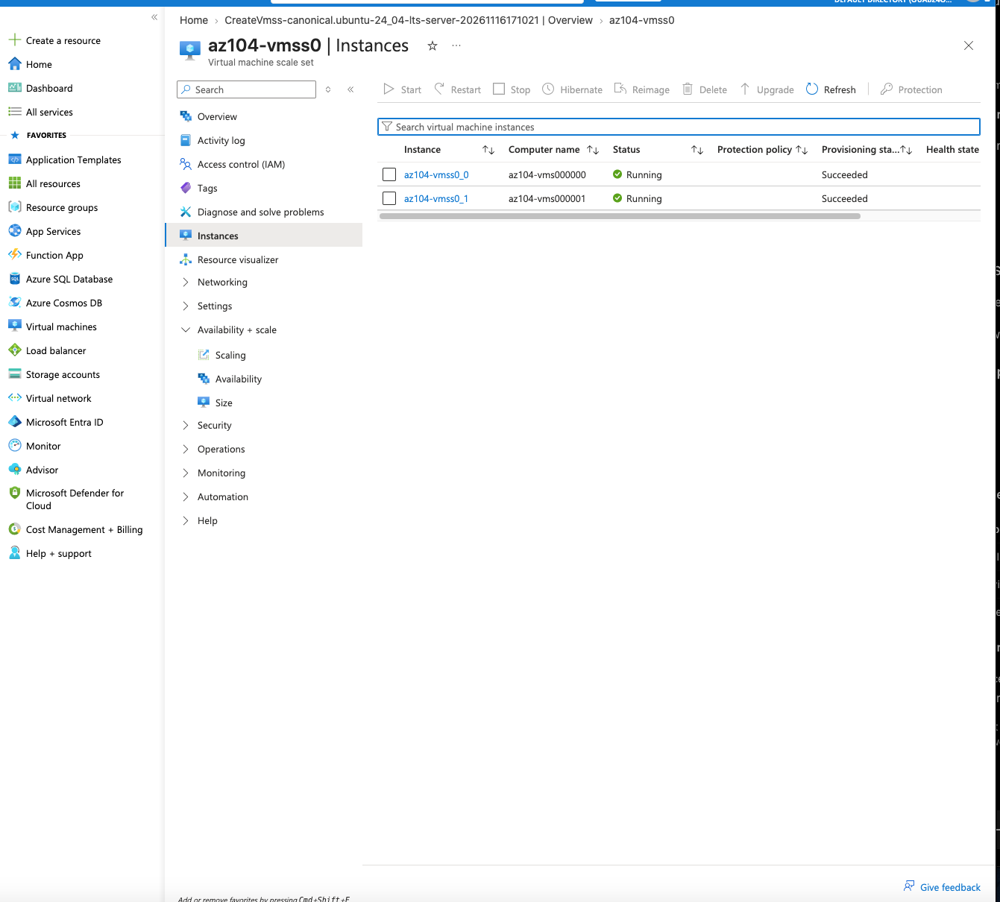
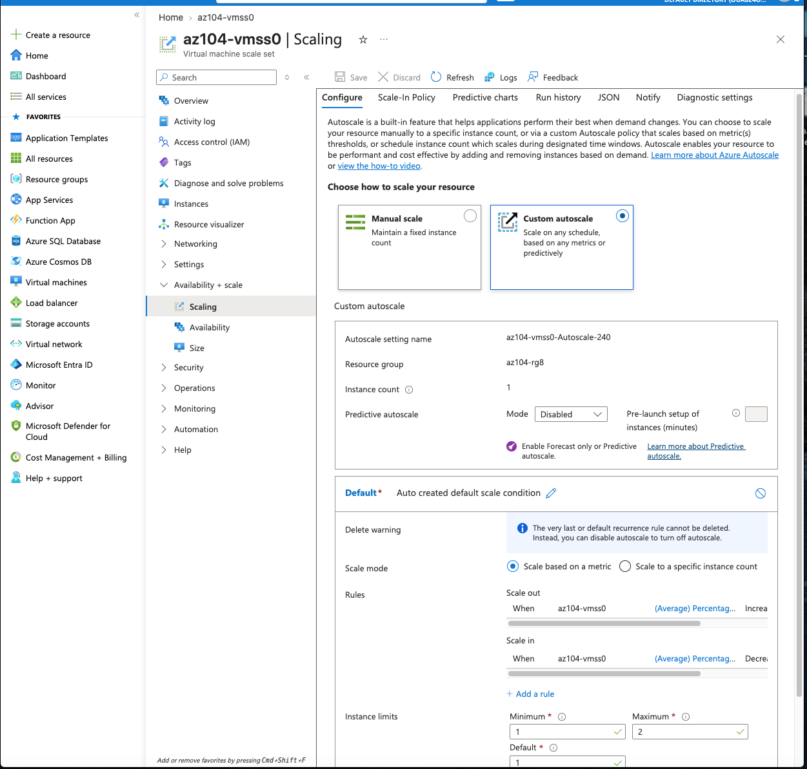

# Lab 08 — Manage Virtual Machines

## Objective

Deploy and manage Azure virtual machines, configure availability
zones, and practice VM administration.

## Environment

- Subscription: Azure subscription 1
- Resource group: `az104-rg8`
- Region: East US
- Virtual network: `vnet-eastus-1`
- Subnet: `snet-eastus-1` (`172.16.0.0/24`)

## Task 1 — Deploy Azure Virtual Machines Across Availability Zones

### VM 1: az104-vm0
i
| Setting | Configuration |
|---|---|
| Name | `az104-vm0` |
| Operating system | Windows Server 2025 Datacenter: Azure Edition |
| Size | `Standard_D2s_v3` |
| Availability zone | Zone 1 |
| OS disk | Premium SSD |
| Public IP | None |
| Public inbound ports | None |
| Security | Trusted Launch, Secure Boot, vTPM |
| Boot diagnostics | Enabled with managed storage |
| Auto-shutdown | 19:00 Helsinki time |

### Verification

- [x] Azure deployment completed successfully.
- [x] VM power state verified as Running.
- [x] Availability zone verified as Zone 1.
- [x] VM agent status verified as Ready.
- [x] Screenshot evidence captured.

### Evidence



### VM 2: az104-vm1

| Setting | Configuration |
|---|---|
| Name | `az104-vm1` |
| Operating system | Windows Server 2025 Datacenter: Azure Edition |
| Size | `Standard_D2as_v6` |
| Availability zone | Zone 2 |
| Virtual network | `vnet-eastus-1` |
| Subnet | `snet-eastus-2` (`172.16.1.0/24`) |
| OS disk | Premium SSD |
| Public IP | None |
| Public inbound ports | None |
| Security | Trusted Launch, Secure Boot, vTPM |
| Boot diagnostics | Enabled with managed storage |
| Auto-shutdown | 19:00 Helsinki time |

### Verification — VM 2

- [x] Azure deployment completed successfully.
- [x] VM power state verified as Running.
- [x] Availability zone verified as Zone 2.
- [x] VM agent status verified as Ready.
- [x] Screenshot evidence captured.

### Evidence — VM 2



### Lessons Learned

- Azure VM size availability can differ between availability zones.
- `Standard_D2s_v3` was unavailable in Zone 2, so an alternative SKU was selected.
- Both VMs were deployed in East US across separate availability zones.
- Both VMs use the same virtual network but different subnets.
- Neither VM has a public IP address.

## Task 2 — Resize an Azure Virtual Machine (Vertical Scaling)

### Objective

Practice vertical scaling by increasing the CPU and RAM of `az104-vm0`, then restoring its original size.

### Resize Results

| Property | Original | Scaled Up | Final |
|---|---|---|---|
| VM size | `Standard_D2s_v3` | `Standard_D4s_v3` | `Standard_D2s_v3` |
| vCPUs | 2 | 4 | 2 |
| RAM | 8 GiB | 16 GiB | 8 GiB |
| Availability Zone | Zone 1 | Zone 1 | Zone 1 |

### Procedure

1. Opened `az104-vm0` in Azure Portal.
2. Attempted to resize using **Availability + scale → Size**.
3. The **Resize** button remained disabled.
4. Stopped and deallocated the VM.
5. Confirmed inherited **Owner** permissions.
6. Verified available resize options using Azure CLI.
7. Resized the VM to `Standard_D4s_v3`.
8. Restored the original size, `Standard_D2s_v3`.
9. Verified the final power state was `VM deallocated`.

### Azure CLI Commands

```bash
az vm list-vm-resize-options --resource-group az104-rg8 --name az104-vm0

az vm resize --resource-group az104-rg8 --name az104-vm0 --size Standard_D4s_v3

az vm show --resource-group az104-rg8 --name az104-vm0 --query "hardwareProfile.vmSize" --output tsv

az vm resize --resource-group az104-rg8 --name az104-vm0 --size Standard_D2s_v3

az vm get-instance-view --resource-group az104-rg8 --name az104-vm0 --query "instanceView.statuses[?starts_with(code, 'PowerState/')].displayStatus" --output tsv

```

### Verification

- [x] Target size confirmed through Azure CLI.
- [x] VM resized to `Standard_D4s_v3` (4 vCPUs, 16 GiB RAM).
- [x] Original size `Standard_D2s_v3` restored.
- [x] Final provisioning state: `Succeeded`.
- [x] Final power state: `VM deallocated`.

### Lessons Learned

- Azure Portal's Resize button remained disabled, but Azure CLI resizing succeeded.
- VM size compatibility depends on the disk controller type.
- Deallocating a VM can make additional resize options available.
- Deallocated VMs do not incur compute charges, although managed disks can still incur charges.
- Vertical scaling changes a VM's CPU and memory allocation.

## Task 3 — Manage Azure VM Data Disks

### Objective

Create and attach a managed data disk to `az104-vm0`, initialize it using GPT, and format it as an NTFS volume.

### Data Disk Configuration

| Property | Configuration |
|---|---|
| Virtual machine | `az104-vm0` |
| Resource group | `az104-rg8` |
| Disk name | `az104-vm0-datadisk0` |
| Storage type | Standard HDD |
| Disk capacity | 32 GiB |
| LUN | 0 |
| Windows disk number | 2 |
| Partition style | GPT |
| Drive letter | F: |
| File system | NTFS |
| Volume label | `AZ104-Data` |

### Procedure

1. Opened `az104-vm0` in Azure Portal.
2. Navigated to **Settings → Disks**.
3. Selected **Create and attach a new disk**.
4. Configured a 32 GiB Standard HDD managed disk.
5. Applied the configuration and verified the disk attachment.
6. Started the virtual machine.
7. Opened **Operations → Run command → RunPowerShellScript**.
8. Identified Disk 2 as the new 32 GiB RAW disk.
9. Initialized Disk 2 using GPT.
10. Created a partition and formatted it as NTFS.
11. Verified the new F: drive was healthy.
12. Stopped and deallocated the VM to control costs.

### PowerShell Commands

```powershell
# Identify the attached disks
Get-Disk | Select-Object Number, FriendlyName, PartitionStyle, OperationalStatus, Size | Format-Table -AutoSize

# Initialize the new data disk
Initialize-Disk -Number 2 -PartitionStyle GPT

# Verify GPT initialization
Get-Disk -Number 2 | Select-Object Number, PartitionStyle, OperationalStatus, Size | Format-Table -AutoSize

# Create and format the NTFS volume
New-Partition -DiskNumber 2 -UseMaximumSize -DriveLetter F |
    Format-Volume -FileSystem NTFS -NewFileSystemLabel "AZ104-Data" -Confirm:$false
```

### Verification

- [x] Managed data disk created and attached successfully.
- [x] Windows detected the new 32 GiB disk as Disk 2.
- [x] Disk initialized using GPT.
- [x] NTFS volume created with drive letter F:.
- [x] Volume label verified as `AZ104-Data`.
- [x] Health status verified as `Healthy`.
- [x] Operational status verified as `OK`.
- [x] VM deallocated after completing the exercise.

### Lessons Learned

- Azure managed disks can be attached to existing virtual machines.
- Attaching a disk does not automatically initialize or format it inside Windows.
- Azure Run Command allows remote PowerShell execution without a public IP address.
- Disk numbers must be verified before performing initialization or formatting.
- GPT is a modern partition style supported by Windows Server.
- Managed disks continue to incur storage charges while a VM is deallocated.


## Remaining Exercises

- [x] Deploy second VM in Availability Zone 2.
- [x] Resize a virtual machine.
- [x] Manage VM data disks.
- [x] Deploy a Virtual Machine Scale Set.
- [x] Configure autoscaling.
- [x ] Document cleanup and lessons learned.


## Task 4 — Deploy an Azure Virtual Machine Scale Set

**Status:** Completed

Deployed `az104-vmss0` in resource group `az104-rg8` to practice horizontal scaling and autoscaling.

| Setting | Configuration |
|---|---|
| Region | East US |
| Orchestration mode | Uniform |
| Image | Ubuntu Server 24.04 LTS (Gen2) |
| VM size | Standard_D2as_v4 (2 vCPUs, 8 GiB RAM) |
| Initial instance count | 1 |
| Scaling mode | Manual |
| Authentication | SSH public key (`azureuser`) |
| Virtual network | `vnet-eastus-1` |
| Subnet | `snet-eastus-1` (`172.16.0.0/24`) |
| Public IP | None |
| Load balancing | None |
| OS disk | Premium SSD LRS |
| Security | Trusted Launch, Secure Boot, vTPM |
| Boot diagnostics | Enabled |

**Verification:** Azure reported provisioning state `Succeeded` and `1 out of 1 instances running`.

**Cost awareness:** The Azure Pricing Calculator estimated $0.096/hour per running instance for Linux compute, excluding managed disks and networking.



**Next:** Configure horizontal scaling and autoscaling.


## Task 5 — Horizontal Scaling and Autoscaling

**Status:** Completed

### Manual horizontal scaling

Scaled `az104-vmss0` from 1 to 2 VM instances using **Availability + scale → Scaling** in the Azure Portal.

Verified that both instances were running and had provisioning state `Succeeded`:

- `az104-vmss0_0`
- `az104-vmss0_1`

After verification, scaled the VMSS back down from 2 to 1 instance to reduce compute costs.



### CPU-based autoscaling

Configured **Custom autoscale** using Azure Monitor metrics.

| Setting | Configuration |
|---|---|
| Metric | Percentage CPU |
| Scale-out condition | Average CPU greater than 70% for 10 minutes |
| Scale-out action | Increase instance count by 1 |
| Scale-in condition | Average CPU less than 30% for 10 minutes |
| Scale-in action | Decrease instance count by 1 |
| Cooldown | 5 minutes for each rule |
| Minimum instances | 1 |
| Maximum instances | 2 |
| Default instances | 1 |

**Verification:** Azure confirmed that the autoscaling configuration was saved successfully. After refreshing the Scaling page, Custom autoscale remained selected and both rules were visible.

**Note:** The autoscaling rules were configured and verified, but an actual CPU-triggered scaling event was not tested.



**Cost awareness:** Autoscaling can create additional billable VM instances. The scale set should be stopped or deleted after the lab to avoid unnecessary charges.


## Task 6 — Resource Cleanup and Lessons Learned

**Status:** Completed

### Resource cleanup

1. Changed `az104-vmss0` from Custom autoscale to Manual scale with one instance.
2. Verified that `az104-vm0`, `az104-vm1`, and the remaining VMSS instance were stopped (deallocated).
3. Reviewed the resources in `az104-rg8` before deletion.
4. Deleted resource group `az104-rg8` and its 16 associated resources.
5. Verified that `az104-rg8` no longer existed in the Azure Portal.

**Cleanup result:** All Lab 08 Azure resources were removed. Screenshots and documentation were retained in GitHub.

### Lessons learned

- **Vertical scaling:** Changing VM size adjusts CPU and memory capacity.
- **Horizontal scaling:** VM Scale Sets allow administrators to increase or decrease the number of VM instances.
- **Autoscaling:** Azure Monitor can adjust VMSS capacity automatically using metric-based rules.
- **Managed disks:** Data disks must be initialized and formatted inside the operating system before use.
- **Networking:** Virtual machines can be deployed without public IP addresses.
- **Cost management:** Deallocating VMs stops compute charges, but managed disks can continue incurring storage charges until deleted.

**Verification note:** Manual horizontal scaling was tested. CPU-based autoscaling rules were configured and verified, but CPU-triggered scaling was not tested.

## Status

**Completed** — All Lab 08 exercises documented and Azure lab resources cleaned up.
